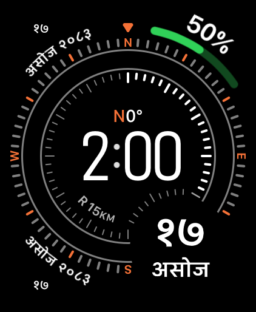

<div align="center">
  <h1>NepalKit</h1>
  <p>Today's Bikram Sambat date in your Mac's menu bar and on your Apple Watch.</p>
</div>

<p align="center">
  <a href="https://github.com/dibas-np/NepalKit/releases/latest"></a>
  
  <a href="LICENSE"></a>
</p>

<p align="center">
  
</p>

## Features

- Today's Bikram Sambat date in the menu bar, with optional weekday, year and clock.
- A month calendar with Gregorian dates, plus 2083's festivals and public holidays.
- Nepal Time (UTC+5:45) alongside your local time.
- Bikram Sambat ↔ Gregorian conversion.
- Latin or Devanagari digits, Nepali or transliterated names.
- Siri and Shortcuts: today's, tomorrow's and yesterday's date, and conversion.
- A standalone Apple Watch app with complications.

Works offline. No account, analytics or telemetry; the only network access is the update check.

## Install

Requires macOS 26.6 or later. [Download the latest release](https://github.com/dibas-np/NepalKit/releases/latest), open the DMG and drag NepalKit into Applications, or:

```sh
brew install --cask dibas-np/tap/nepalkit
```

Releases are signed and notarized, and the app updates itself through Sparkle.

## Usage

Click the date in the menu bar. **Today** shows the month grid; click a day to copy it or add it to your calendar. **Convert** converts in either direction. Settings (**⌘,**) controls digits, names, the menu-bar format and launch at login.

Today follows Nepal Time by default; choose **Settings → General → Time zone → My time zone** to follow your Mac's time zone instead.

Ask Siri "What is today's Nepali date with NepalKit". Conversion is available as a Shortcuts action.

## Apple Watch

<p align="center">
  
  
</p>

The Watch app is not on the App Store. Build the **NepalKitWatch Watch App** scheme in Xcode to a watch or simulator. It always follows Nepal Time and needs watchOS 26 or later.

## Supported dates

1975–2084 BS (13 April 1918 – 12 April 2028). Month lengths come from a bundled table based on [askbuddie/bikram-sambat](https://github.com/askbuddie/bikram-sambat), with a few local corrections. **2084 is a provisional projection** until the official Nepali Patro is published. See [SOURCES.md](SOURCES.md) for provenance.

## Swift package

The calendar engine is available as [NepalKitCore](https://github.com/dibas-np/NepalKitCore), an MIT-licensed Swift package mirrored from [NepalKitCore/](NepalKitCore/).

## Development

Requires Xcode 27.

```sh
git clone https://github.com/dibas-np/NepalKit.git
open NepalKit/NepalKit.xcodeproj
```

Run `./scripts/check-all.sh` to build and run every test suite. See [CONTRIBUTING.md](.github/CONTRIBUTING.md).

## License

[GPL-3.0-or-later](LICENSE), except [NepalKitCore/](NepalKitCore/), which is [MIT](NepalKitCore/LICENSE). The calendar base is MIT-licensed, copyright (c) 2023 Ask Buddie ([notice](NepalKitCore/Sources/NepalKitCore/Resources/AskBuddie-LICENSE.txt)).
