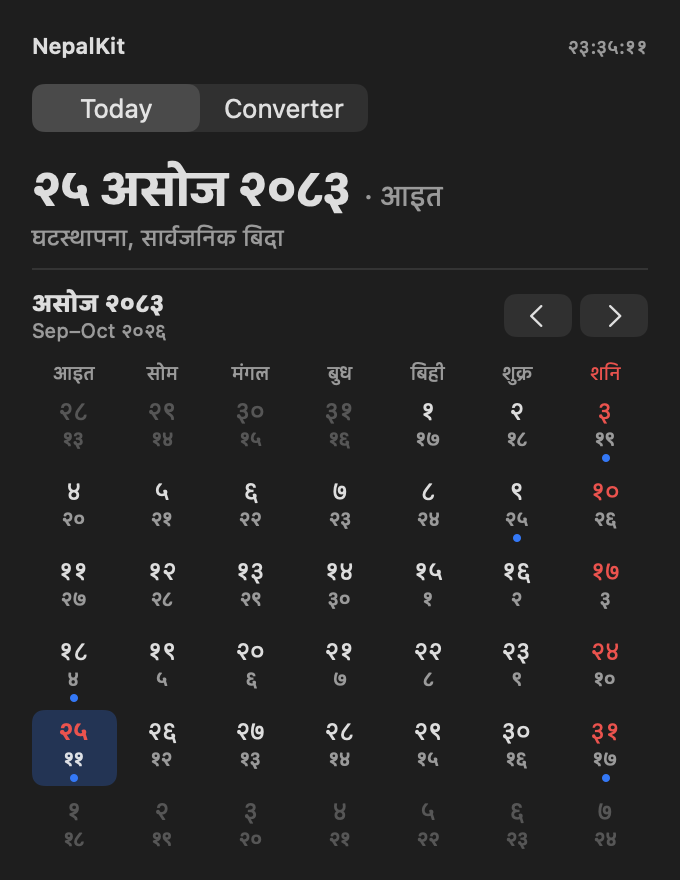
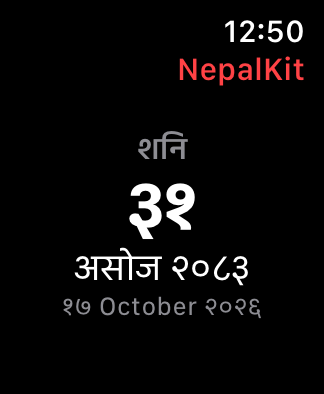

<div align="center">
  <h1>NepalKit</h1>
  <p>Today's Bikram Sambat date in your Mac's menu bar and on your Apple Watch.</p>
</div>

<p align="center">
  <a href="https://github.com/dibas-np/NepalKit/releases/latest"></a>
  <a href="LICENSE"></a>
</p>

<p align="center">
  
</p>

## Features

- Today's Bikram Sambat date in the menu bar, with an optional weekday, year, and time.
- A month calendar with Gregorian dates, and the festivals and public holidays of 2083.
- Nepal Time (UTC+5:45), with your local time beside it when the two differ.
- Conversion from Bikram Sambat to Gregorian and back.
- Latin or Devanagari digits, and Nepali or transliterated month and weekday names.
- Siri and Shortcuts actions for today's, tomorrow's, and yesterday's date, and for conversion.
- A standalone Apple Watch app with complications.

NepalKit works offline and has no account, analytics, or telemetry. It goes online only to check for updates.

## Install

NepalKit needs macOS 26.6 or later. [Download the latest release](https://github.com/dibas-np/NepalKit/releases/latest), open the DMG, and drag NepalKit into **Applications**. To install with Homebrew instead, run:

```sh
brew install --cask dibas-np/tap/nepalkit
```

Each release is signed and notarized. NepalKit updates itself through Sparkle.

## Usage

Click the date in the menu bar to open NepalKit.

- **Today** shows the month calendar. Click a day to see its details, then click **Copy** or **Add to Calendar**.
- **Converter** converts a date in either direction.
- The gear button opens Settings, where you choose the digits, the month names, the menu-bar format, and launch at login.

The date follows Nepal Time by default. To follow your Mac's time zone instead, choose **Settings** > **General** > **Time zone** > **My time zone**.

To ask Siri, say "What is today's Nepali date with NepalKit" or "What is tomorrow's Nepali date with NepalKit". **Settings** > **General** > **Siri & Shortcuts** lists a phrase for each action.

## Apple Watch

<p align="center">
  
  
</p>

The Watch app is not on the App Store. To install it, run the **NepalKitWatch Watch App** scheme in Xcode on a watch or a simulator. It needs watchOS 26 or later and always follows Nepal Time.

## Supported dates

NepalKit converts 1975 through 2084 BS, which is 13 April 1918 through 12 April 2028. The month lengths come from a bundled table based on [askbuddie/bikram-sambat](https://github.com/askbuddie/bikram-sambat), with 14 month lengths corrected. 2084 is a provisional projection until the official Nepali Patro for that year is published. [SOURCES.md](SOURCES.md) records where each value comes from.

## Swift package

The calendar engine is [NepalKitCore](https://github.com/dibas-np/NepalKitCore), an MIT-licensed Swift package mirrored from [NepalKitCore/](NepalKitCore/).

## Development

See [CONTRIBUTING.md](.github/CONTRIBUTING.md).

## License

NepalKit is [GPL-3.0-or-later](LICENSE), except [NepalKitCore/](NepalKitCore/), which is [MIT](NepalKitCore/LICENSE). The calendar table's base is MIT-licensed, copyright (c) 2023 Ask Buddie. See [its notice](NepalKitCore/Sources/NepalKitCore/Resources/AskBuddie-LICENSE.txt).
